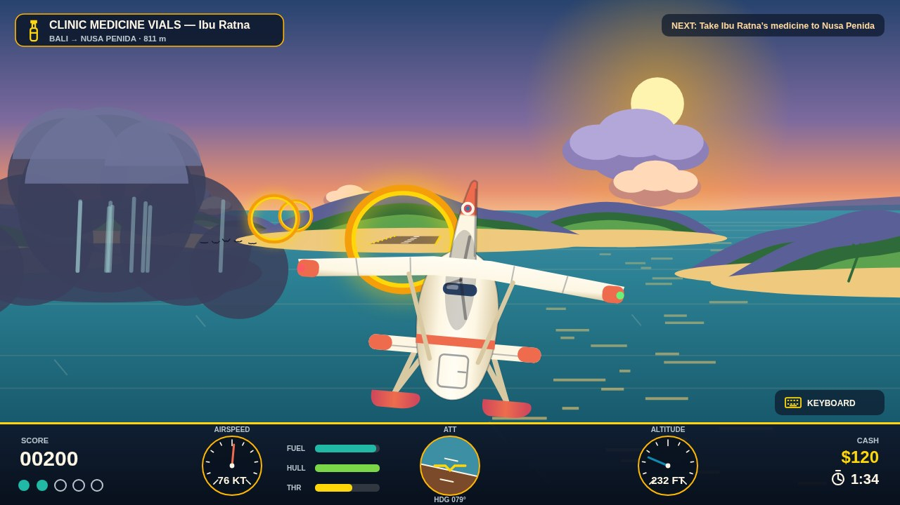
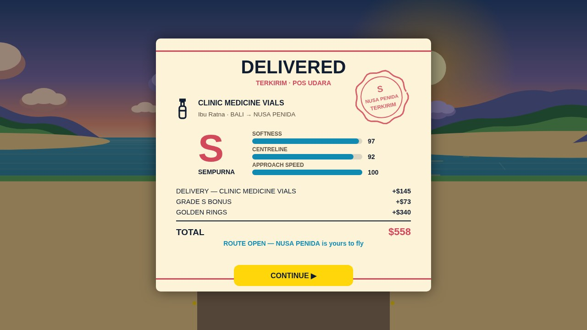
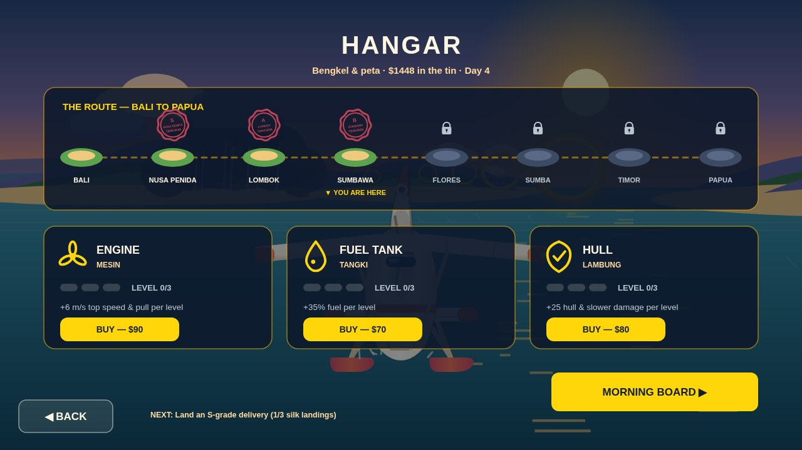
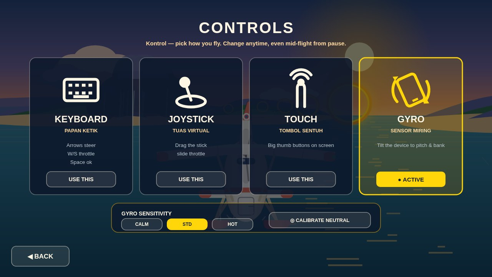

# SENJA HOPPER — Pos Udara

**Fly the mail. Thread the rings. Earn every stamp from Bali to Papua.**

Senja Hopper is a golden-hour seaplane delivery game set in the Indonesian
archipelago. From a chase camera behind your aircraft you roll down the
water, lift off into the sunset, thread golden rings, dodge storm cells and
bird flocks, and put the plane down on the far island's water strip — soft,
centred, at approach speed — to earn a graded **DELIVERED** receipt and a
collectible island postmark stamp: **TERKIRIM**.

## The game

- **Real flight feel** — water takeoff roll, throttle / pitch / bank with a
  working stall, crosswind and gusts, fuel burn, storm cells that chew the
  hull, bird flocks that cost you if you hit them and pay if you skim past.
- **Graded landings** — every arrival is scored on softness, centreline and
  approach speed (grades S–D) and settled on a paper receipt with a full pay
  breakdown and the island's own postmark stamp.
- **An 8-island campaign** — Bali → Nusa Penida → Lombok → Sumbawa → Flores →
  Sumba → Timor → Papua. Stamps unlock the next island east; customers come
  back (Ibu Ratna's second medicine run arrives on day 5, in worse weather).
- **Named customers, story cargo** — clinic medicine vials, a wedding dress,
  exam papers, a sick turtle, baby supplies. Every ticket and every receipt
  carries a person, not a parcel number.
- **Hangar progression** — engine, fuel tank and hull upgrades (3 levels
  each) that visibly change performance, perfect-landing streaks with
  escalating bonuses, 6 challenges with live progress, career pilot stats.
- **Pilot's choices** — before every leg: extra fuel, or a bonus cargo crate
  that pays more and makes the plane heavier and stall-prone. Late pay decays
  against a visible countdown.

## Four ways to fly — the CONTROLS screen

One flight model, four control schemes, switchable any time — even mid-flight
from the pause menu. The choice persists in your save, and HOW TO PLAY always
teaches the scheme you actually fly with.

- **KEYBOARD** — arrows / WASD to pitch and bank, W/S throttle, Space confirm.
- **JOYSTICK** — an on-screen analog stick (drag to pitch and bank) plus a
  throttle slider. Works with mouse or finger.
- **TOUCH** — big two-thumb on-screen buttons: pitch, bank, throttle.
- **GYRO** — tilt the device to pitch and bank. On iOS, permission is
  requested from your tap on the GYRO card; a calibration step captures your
  neutral tilt, with CALM / STD / HOT sensitivity. On devices without the
  sensor the card honestly reads NOT AVAILABLE ON THIS DEVICE.

## Play it

Open `game/index.html` in any modern browser (or serve the `game/` folder
statically). No build step, no network, no dependencies — the whole game is
hand-written ES modules and one canvas. Progress is kept in a guarded
localStorage save.

## Layout

- `game/` — the game: `index.html` plus single-job modules under `src/`
  (`config`, `rng`, `save`, `audio`, `controls`, `world`, `orders`,
  `campaign`, `physics`, `autopilot`, `icons`, `render`, `screens`,
  `shots`, `main`). The four control schemes live in `controls.js` and all
  feed one normalized input frame — the flight model never knows which
  scheme is active.
- `main.ts` — the hand-in program: copies the game and screenshots and
  writes the dossier with the vendored make.fun library.
- `tests/` — a headless harness that flies the day-1 medicine run end-to-end
  on autopilot, exercises every control scheme's mapping (including gyro
  calibration and the landscape axis swap), and checks stalls, storm damage,
  ditching, settlement, hangar purchases and save round-trips.
- `screenshots/` — the four staged frames, each one played forward from a
  real seeded game state by the autopilot or the real settlement code.

SPDX-License-Identifier: MIT
